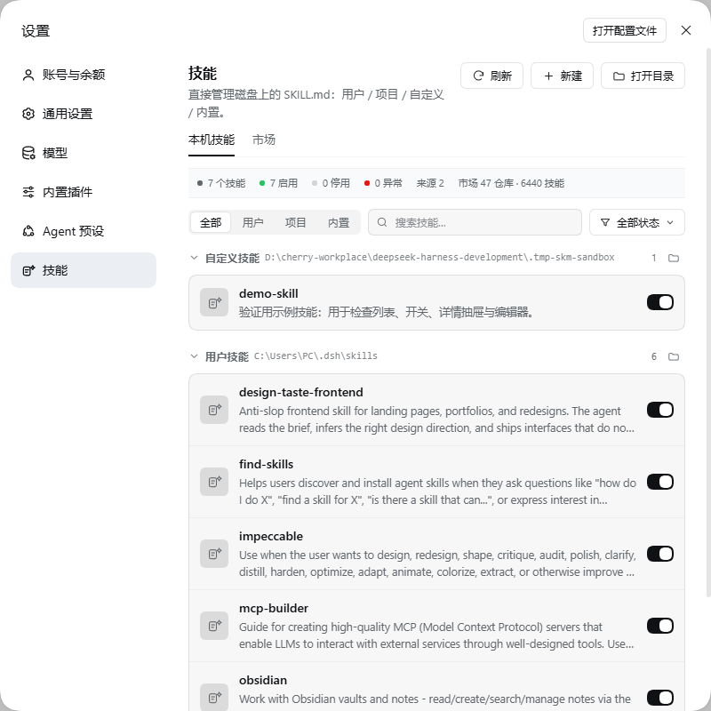
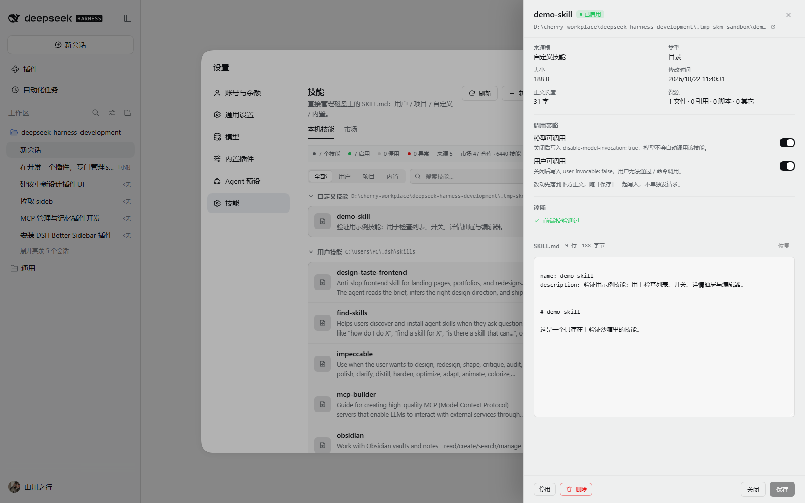
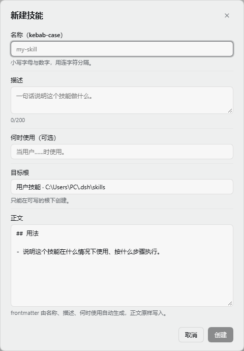

# dsh-skill-manager · 技能管理

**dsh-skill-manager** 是 **DeepSeek Harness（DSH）** 的一个插件：在设置里开出一个技能管理页，直接管理磁盘上的全部技能（`SKILL.md`）——看清单、启停、看诊断、内联编辑、新建、删除到回收站，以及从本机技能市场克隆安装。除了设置页，主页面侧边栏「自动化任务」下面还有一个**技能管理**快速入口，点开就是同一个页面。

- 包名 `dsh-skill-manager`，版本 `0.1.7`，许可 MIT
- 目标宿主：**DSH 0.2.1-rc.2**（`package.json` 的 `engines.dsh: ">=0.2.1-rc.2"`）
- 运行时依赖只有 `yaml`；`@deepseek-ai/cordis` 由宿主提供（`peerDependencies`）

## 界面

设置 → 技能（自有绘制，非宿主默认表单）：

| 浅色 · 列表 | 浅色 · 详情抽屉 |
|---|---|
|  |  |

| 浅色 · 新建 | 深色 · 市场 |
|---|---|
|  |  |

设置导航里的图标也是自有绘制（宿主只为未知 section 兜底齿轮，插件替换本行字形）：


主页面侧边栏的快速入口（`sidebar.panellist` + `main` 双槽注册，排在「自动化任务」之后）：


## 1. 定位（与宿主的关系）

一句话：**技能文件的旁挂管理器**——技能数据始终留在各技能根的磁盘目录里，插件只是在同一个文件系统上读写它们，并把这套扫描与校验结果做成可操作的设置页。

与宿主的三条关系：

1. **同口径扫描**：技能根的 rank 顺序、frontmatter 解析、issue 判定都对齐宿主 `@deepseek-ai/dsh-skill-filesystem` 的同一张 rank 表（见 §4），所以面板里的「启用 / 停用 / 异常 / 被遮蔽」与宿主实际加载结果一致，不前移也不后移。
2. **不接管加载**：插件不注册技能、不改宿主源码、不往 profile 里塞技能；它只通过自己的同源路由 `/skill-manager/api/*` 读写磁盘，宿主原有的技能发现链路完全不变。
3. **补齐宿主没有的前端操作**：宿主只提供技能加载，没有"停用"开关、没有编辑页、没有回收站。本插件用 `_disabled/` 与 `_trash/` 两个目录约定把这几件事补上（见 §6），并保证**任何操作都不是 `rm -rf` 用户目录**。

包构成（`dsh.bundle.patch` 挂载）：`lib/` 为 host 半侧（路由 + 扫描 + 文件操作），`client/client.js` 为浏览器半侧（`settings.section` 设置页 + `sidebar.panellist` / `main` 主页面板，无构建、无 JSX），`cordis.patch.yml` 只插入本插件自己的一行宿主条目。

## 2. 功能清单

| 能力 | 行为 |
|---|---|
| 清单 | `overview` 一次拉全量：按技能根分组，列出启用 / 停用 / 异常；带来源根、调用策略（模型可调用 / 用户可调用）、正文长度、大小、修改时间、被遮蔽标记 |
| 插件同名提示 | 读取当前 live Agent 的宿主 `skills` 服务，把 provider 为 `plugin-hub:<pluginId>` 的技能与扫盘结果按 name 对照：rank 350 的插件技能胜出时，行上标「插件同名」并在列表上方显示说明横幅；宿主没有该服务时静默降级（`pluginSkills.available=false`），不影响其余扫描 |
| 启停 | 行内开关，**移动**而非改标志：`<root>/<name>` ⇄ `<root>/_disabled/<name>`；乐观更新，失败回滚 + toast |
| 三态调用策略（软禁用） | 行内徽章即菜单：默认 / 仅手动（写 `disable-model-invocation: true`，模型看不到但 `/name` 仍可用）/ 都不可调用。**只改 frontmatter 的两个键**，注释、键序、正文与换行逐字节保留，条目留在原路径；带 hash 并发保护，改不成就 400 而不是写坏 YAML |
| 批量处理 | 选择模式勾选多条（只读与异常自动跳过），底部操作条批量启用 / 停用 / 删除；串行执行、逐条返回结果，单条失败不影响其余 |
| 调用账本 | 从宿主会话历史统计 7/30/90 天调用次数与最后使用时间（只认 `tool/call` 的 `skill` 工具与 `/name` 的 `skill-invocation` source）；可按「从未使用」筛选、按调用次数排序，详情里也有次数。走 `ctx.sessionQuery`，有墙钟预算与会话上限，服务缺失时只隐藏次数 |
| 工作区切换 | 工具栏可切「当前会话 / 最近目录 / 手输路径」，所有请求回传 `cwd`，项目级技能根按该目录重新解析；选择记在 localStorage |
| 导入本地技能包 | 选一个文件夹或 `.md`：目录自己有 `SKILL.md` 就整包导入，否则递归发现并拍平到技能根第一层；不合法 / 重名逐条跳过并说明原因，先落 `.import-<name>-<ts>` 再 rename |
| 诊断 | 每个技能带 issue 列表：BOM、缺 frontmatter、YAML 解析失败（带行号）、`name` / `description` 缺失或非法、调用键非法、未知顶层键、同根重名、被更高 rank 遮蔽、根目录不存在、读取失败；error / warn 分级展示 |
| 查看与编辑 SKILL.md | 详情抽屉展示完整原文与元信息；保存前重算 frontmatter 并回传 issues；写盘用"同目录临时文件 + rename"，保留原 EOL，可选去 BOM，内容上限 256 KiB |
| 保存冲突 | 保存必须带读取时的 `hash`；磁盘内容被别人改过 → `409 conflict`，**绝不覆盖**，前端给「重新载入」 |
| 新建 | 名称（kebab-case、单路径段）+ 描述（必填）+ 可选「何时使用」/ 正文 / 调用策略；只在可写根生成目录技能 `<root>/<name>/SKILL.md`，重名 409 |
| 删除到回收站 | 移入 `<root>/_trash/<name>@<时间戳>/`，同名自动加序号；**不删除任何内容** |
| 本地市场安装 | 读本机技能市场克隆，按仓库分组、可搜索；「安装」= 复制目录（含 `references/` `scripts/` `assets/`）到可写根（默认 `user-dsh`），同名默认不覆盖，先复制到 `.install-<name>-<ts>` 再 rename，不留半成品 |
| 安装来源账本 | 安装时写 `<marketDir>/../install-state.json`（repo/folder/目标根/时间/逐文件 sha256）。「已安装」按 `repo+folder` **且**目标根属于当前工作区精确匹配，不按名字猜：手写同名技能标「同名已存在」，市场侧改动后标「有更新」并可一键重装（旧版进 `_trash/`）。哈希采样不完整（>200 文件 / 单文件 >1 MiB / 目录更深）时给 `unknown`，不会谎报「有更新」 |
| 打开目录 | 用系统文件管理器打开扫描过的根或其直接子项（Windows 走 `explorer.exe`） |
| 内置技能 | `bundled` 根只读：页面标「只读」，隐藏开关，危险操作禁用 |
| 侧边栏快速入口 | 主页面侧边栏「自动化任务」下方新增「技能管理」一行（图标为卡片 + 星火，与设置导航同形），点击切换到同一套页面的主面板视图；面板自带滚动容器与 960px 内容列，设置页入口保持不变 |

页面交互细节（分组折叠、搜索防抖、状态过滤、抽屉焦点陷阱、深色模式只走主题 token、<640px 单列）见 [`docs/ui-spec.md`](./docs/ui-spec.md)；接口字段与错误码见 [`docs/api-contract.md`](./docs/api-contract.md)（v2 契约，v1 字段全部保留）。

## 3. 安装

宿主只对**真实目录形态**的包做 `@deepseek-ai/*` 解析，所以必须打成 tarball 安装，**不要用 `link:`** 或直接拷贝源码目录。

在本工作区的插件目录里打包（产物落到工作区的 `migration/dist/`）：

```powershell
cd plugin-library\dsh-skill-manager
npm pack --pack-destination ..\..\migration\dist
# 产出：..\..\migration\dist\dsh-skill-manager-0.1.7.tgz
```

再用宿主插件管理器装这个 tgz，任选一条：

- **宿主工具**：`plugin_manager({ action: "install_bundle", target: "<abs-path>\\migration\\dist\\dsh-skill-manager-0.1.7.tgz" })`
- **Web GUI**：设置 → 插件 → 安装，选中刚生成的 `.tgz`
- 安装后重载 / 重启 DSH；设置左侧出现「技能」（`settings.section`，由本包 `cordis.patch.yml` 自动挂载），主页面侧边栏「自动化任务」下面出现「技能管理」

迭代流程：改源码 → **递增版本号** → 重新 `npm pack` → 重装 tarball（包管理器按 tarball 内容做缓存，同版本号重打不一定生效）。

运行要求：Node.js ≥ 20。`migration/dist` 目录不存在时先建：`New-Item -ItemType Directory -Force ..\..\migration\dist`。

## 4. 技能根优先级表

顺序即优先级（rank 越小越优先）；**同名技能先到先得**，低 rank 的同名项标为 `shadowed`（仍展示，不隐藏）。

插件中心（dsh-plugin-hub）提供的技能不落在磁盘根里，而是通过宿主 `skills` 服务暴露，
provider 形如 `plugin-hub:<pluginId>`，固定 rank **350**（介于 custom 300 与 user-dsh 400）：

| rank | rootId | 路径 | kind | 可写 |
|---:|---|---|---|---|
| 100 | `project-dsh` | `<projectRoot>/.dsh/skills` | project | ✅ |
| 200 | `project-agents` | `<projectRoot>/.agents/skills` | project | ✅ |
| 300 | `custom:<n>` | 插件 Config `customSkillDirs` 里的每个目录 | custom | ✅ |
| 350 | `plugin-hub:<pluginId>` | 宿主 `skills` 服务（不在本插件扫描面） | — | ❌ 只读 |
| 400 | `user-dsh` | `<dshHome>/skills`（跳过 `.system` 子目录） | user | ✅ |
| 500 | `user-agents` | `<agentsHome>/skills` | user | ✅ |
| 600 | `bundled` | Config `bundledSkillDir`（配置了才有） | bundled | ❌ 只读 |

补充约定：

- `projectRoot` = 从请求 `cwd` 向上找最近含 `.git` 的祖先；找不到就用 `cwd` 本身。
- 页面不传 `cwd` 时，Host 用**当前活跃会话的生效目录**（取最新 live agent 的 `workingDirectory.get(session)`）推导项目根，所以「项目技能」跟着你当前会话走；没有会话时回退宿主默认目录。
- 发现规则与宿主一致：只扫根目录的**直接子项**——`<name>/SKILL.md`（目录技能）或 `<name>.md`（单文件技能），**不递归**。
- 根不存在时不报错：仍出现在 `roots[]` 里，页面显示为「未创建」。

## 5. 配置项

配置写在 profile 补丁里 `skill-manager` 那一行的 `config:`（本插件**没有**声明 Cordis `Config` schema，因此不会在设置页生成表单；好处是这些键保持普通字段，改完重载插件即生效）：

```yaml
- insert:
    - id: skill-manager
      name: 'dsh-skill-manager'
      config:
        customSkillDirs:
          - 'D:/my-skills'
        marketDir: 'D:/cherry-workplace/skills-market'
```

| 键 | 类型 | 默认值 | 说明 |
|---|---|---|---|
| `customSkillDirs` | `string[]` | `[]`（不扫描自定义根） | 额外的技能根，按数组顺序对应 rank 300 起的 `custom:<n>`；可写 |
| `marketDir` | `string` | `~/.dsh/skills-management/market` | 本机技能市场克隆的根目录；不存在时市场视图显示空状态 |
| `dshHome` | `string` | `%DSH_HOME%`，无则 `~/.dsh` | 用户级 DSH 目录；`user-dsh` 根 = `<dshHome>/skills` |
| `agentsHome` | `string` | `%DSH_AGENTS_HOME%`，无则 `~/.agents` | 用户级 agents 目录；`user-agents` 根 = `<agentsHome>/skills` |
| `bundledSkillDir` | `string` | 未设置（不出现 `bundled` 根） | 随包分发/内置只读技能目录；设了就按 rank 600 只读扫描 |

> 不加配置时全部走默认值：本机 `~/.dsh/skills` 实际是指向 `~/.zcode/skills` 的 junction，插件按真实路径扫描，不做额外解析。

## 6. 已知限制

- **宿主没有原生停用开关**：本插件的「停用」是把条目移进 `<root>/_disabled/`。宿主只扫根目录的直接子项，因此移进去的技能对宿主不可见——这就是停用效果的来源，但**目录位置变了**，外部脚本若硬编码原路径需要自行适配。需要「模型看不到但 `/name` 仍可用」时改用三态调用策略（写 `disable-model-invocation`），路径不变。
- **删除 = 移入回收站**：去向是 `<root>/_trash/<name>@<timestamp>/`。插件不提供"永久删除"，回收站需要你手动清理；反过来说，误删可以原样移回去恢复。
- **`bundled` 只读**：`bundled` 根下不能启停、编辑、新建、删除、安装，接口返回 `403 read-only`。
- **市场只读本机克隆**：不联网、不拉取、不做远端同步。市场目录内容由你在 DSH 之外的克隆/同步流程维护；插件只负责把克隆里的技能目录复制进技能根。安装会记一条账本（`install-state.json`，与 `skills-market-sync.json` 同目录），因此能显示「有更新」并按需重装，但**不会自动更新**。
- **调用账本受会话历史限制**：只统计最近 90 天、最多 250 个会话，且有 6s 墙钟预算；超出时返回 `sessions.truncated=true`，数字偏小而不是报错。会话历史本身需要宿主挂载 `sessionQuery` 服务，否则账本整块降级（页面照常可用）。
- **设置导航图标靠「防御式装饰」**：宿主 `settings.section` 只接受 `id / order / label`，外壳 `navIcon(id)` 对未知 id 一律兜底成齿轮，于是本插件的导航行原本会和「设置」共用一个齿轮。`client/client.js` 的 `installNavGlyph` 在设置面板出现时**只**替换"文案等于本插件 nav 文案"那一行：隐藏原 `svg`、插入 16×16 / stroke 1.3 的「卡片 + 星火」字形；DOM 结构不符或无 `MutationObserver` 时一行都不碰，`ctx.effect` 清理会还原。**移除条件**：宿主给 `settings.section` 加上 `icon` 参数后，删掉 `NAV_PANEL_SELECTOR` / `NAV_GLYPH_ATTR` / `NAV_GLYPH` 与 `navGlyphElement` / `decorateNavRow` / `installNavGlyph`。
- **主面板是第二处挂载点**：宿主 `main` 槽只给一个满高容器（flex 列 + `overflow:hidden`），滚动、960px 内容列和顶部留白都由插件的 `.sm-panel*` 负责；`sidebar.panellist` 只传 `{ size, active }`，图标是纯装饰，可访问名由宿主行提供。宿主要是将来为主面板提供统一页壳，可以整段删掉 `.sm-panel` / `.sm-panel-scroll` / `.sm-panel-content` 这层包裹。
- **同名技能不合并**：按 rank 先到先得，被遮蔽项仍在列表里并标 `shadowed`，不会自动消除。
- **插件技能只做同名提示，不做管理**：插件中心（plugin-hub）的技能不在本插件的扫描面里，`overview` 只读取宿主 `skills` 服务中 provider 为 `plugin-hub:*` 的条目用于对照，不能在技能管理页启停/编辑它们。反向情况（插件技能被 project/custom 本地技能遮蔽）宿主 `list()` 不会返回插件条目，V1 不做反向枚举，只按 rank 说明。当前没有 live Agent 或宿主 `skills` 服务不可用时，`pluginSkills.available=false`，列表照常展示、不报错。
- **没有重命名 / 跨根移动 / 回收站浏览**：当前支持单条目与批量（勾选多条）的启停、删除、新建、导入、安装，但重命名、跨根搬移、以及 `_trash/` 的浏览与恢复还没做——回收站仍需手动整理。
- **导入不做 zip**：只接受文件夹与 `.md`（运行时依赖只有 `yaml`，解包要新增依赖）。
- **扫描不递归**：深层嵌套的技能目录不会被发现；单文件技能只认根目录下的 `<name>.md`。

## 7. 验证方式

完整的验证方法（含隔离 profile 起 web host、主题 token 实测值、页面检查清单）见 [`docs/verification.md`](./docs/verification.md)。最短路径：

```powershell
cd plugin-library\dsh-skill-manager
D:\nodejs\node.exe test\smoke.mjs         # 扫描 / lint / 启停 / 回收站 / 保存冲突 / 创建 / 市场
D:\nodejs\node.exe test\routes-smoke.mjs  # 13 条路由：状态码、错误信封、同源门、认证栅栏、disposer、插件同名标注与降级、三态调用/批量/导入/调用账本
D:\nodejs\node.exe test\key-parity.mjs    # zh/en 字典 key 集合一致
D:\nodejs\node.exe --check client\client.js
```

### 7.1 静态自检（不需要宿主）

```powershell
# 两个语言包必须是合法 JSON（UTF-8 无 BOM）
node -e "JSON.parse(require('fs').readFileSync('plugin-library/dsh-skill-manager/locale/en.json','utf8'))"
node -e "JSON.parse(require('fs').readFileSync('plugin-library/dsh-skill-manager/locale/zh.json','utf8'))"

# 浏览器半侧单文件语法（client/client.js 存在时）
node --check plugin-library/dsh-skill-manager/client/client.js
```

### 7.2 host 扫描 / 启停 / 保存冲突

在已登录的 DSH Web 页面里打开 DevTools 控制台（同源 `fetch` 才会过 `Origin` / `Sec-Fetch-Site` 校验）：

```js
const q = (p, init) => fetch('/skill-manager/api/' + p, { credentials: 'same-origin', ...init }).then(r => r.json())

// 1) 扫描：roots 顺序应为 100 → 200 → 300 → 400 → 500 → 600；counts 四项之和=skills.length
await q('overview?cwd=' + encodeURIComponent(location.href && '<你的项目绝对路径>'))

// 2) 启停往返：state 变 disabled 后，磁盘上应出现 <root>/_disabled/<dirName>；再切回应回到原位
await q('skill/toggle', { method: 'POST', headers: { 'content-type': 'application/json' },
  body: JSON.stringify({ rootId: '<rootId>', dirName: '<dirName>', kind: 'directory', enabled: false }) })

// 3) 保存冲突：用旧的 hash 提交 → 期望 409 conflict（HTTP 状态与 error.code 同时体现）
await q('skill/save', { method: 'POST', headers: { 'content-type': 'application/json' },
  body: JSON.stringify({ rootId: '<rootId>', dirName: '<dirName>', kind: 'directory', state: 'enabled', hash: 'stale-hash', content: '---\nname: x\ndescription: y\n---\n' }) })

// 4) 删除去向：期望 trashed 落在 <root>/_trash/<name>@<yyyyMMddTHHmmss>/
await q('skill/delete', { method: 'POST', headers: { 'content-type': 'application/json' },
  body: JSON.stringify({ rootId: '<rootId>', dirName: '<dirName>', kind: 'directory' }) })

// 5) 市场：available 为 false 时是路径问题（marketDir 不存在），不是接口错误
await q('market?query=&limit=200')
```

### 7.3 页面人工检查清单

- [ ] 设置左侧出现「技能」，点开后列表按 项目 → 用户 → 自定义 → 内置 → 已停用 → 异常 分组，空分组不渲染
- [ ] 主页面侧边栏「自动化任务」下方出现「技能管理」与「MCP 管理」两行；点「技能管理」主面板渲染同一套列表/工具栏，内容可滚动，切回会话后入口仍在
- [ ] 概览条计数与列表条数一致；搜索（name / description / whenToUse / 目录名）与状态过滤生效
- [ ] 行内开关乐观切换，故意拔掉网络后切换会回滚并弹错误 toast，列表不白屏
- [ ] 点行打开详情抽屉：路径可点打开目录、诊断分级正确、正文可编辑、dirty 时「保存」才可用
- [ ] 外部编辑器改同一文件后保存 → 出现 409 冲突红条 + 「重新载入」，磁盘内容未被覆盖
- [ ] 新建：非 kebab-case 名称即时报错；只在可写根下可建；建成后自动定位到该技能
- [ ] 删除：二次确认后条目消失，磁盘上出现在 `_trash/`，没有内容被真删
- [ ] `bundled` 行显示「只读」，开关隐藏，详情里启停/删除/保存全部禁用
- [ ] 市场标签页：目录缺失时整块空状态并给出路径；已安装技能显示「已安装」；安装后用户技能根出现同名目录
- [ ] 深色模式 / 窄屏（<640px）下布局正常，无硬编码色值造成的可读性问题
- [ ] 键盘：`/` 聚焦搜索、Esc 关闭最上层浮层、抽屉内 Tab 焦点不逃逸

## 8. 许可证

MIT。技能内容与市场克隆归各自作者所有，不在本包许可范围内。
